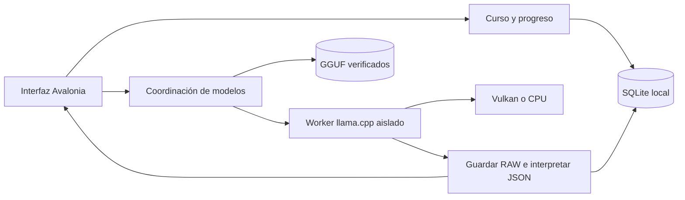
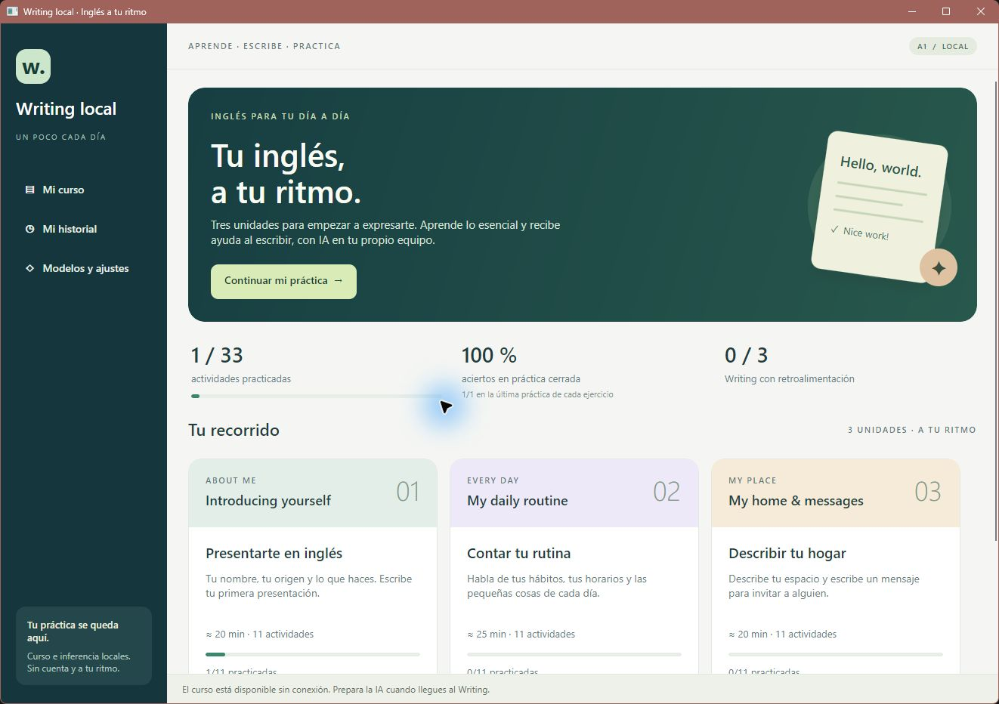
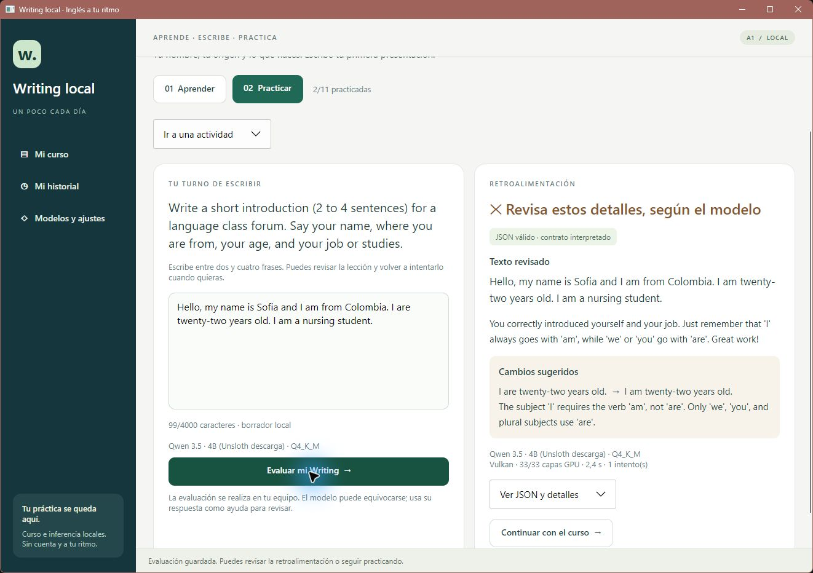
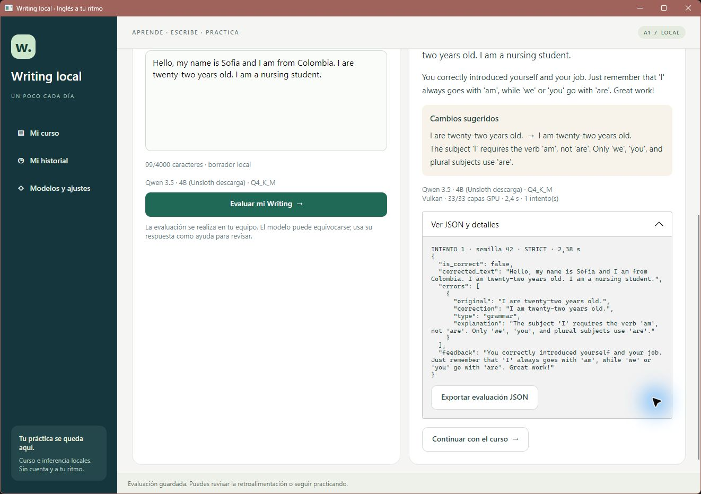
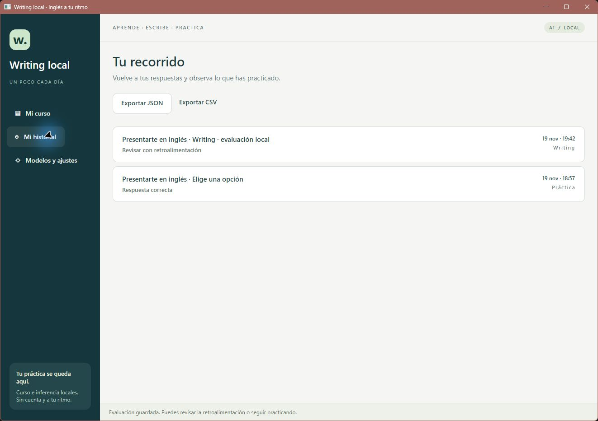

# Aplicación final: implementación y validación de Windows

Fecha local: 19 de noviembre de 2026, America/Guayaquil. Esta entrega corresponde
a la primera etapa del plan: aplicación completa de Windows. El host y la
validación Android del curso son la etapa siguiente; el APK 0.1.6 anterior sigue
siendo el prototipo y no se presenta como APK del curso final.

## Qué se implementó y por qué

Se añadió una solución independiente con Avalonia 12.1.5, .NET SDK 11.0.100 GA y
SQLite. Reutiliza el motor aislado, las descargas verificadas, los prompts
interactivos y el parser ya existentes. No se modificó upstream llama.cpp.
El único añadido al adaptador nativo C# anterior expone el PID de su worker para
medir RSS con atribución al proceso correcto.

La navegación se centra en Curso, Historial y Modelos/Ajustes. El alumno puede leer
las lecciones y practicar sin preparar un modelo. Todas las unidades están
abiertas. La IA se prepara al llegar al Writing; el modo avanzado conserva
control del modelo, cuantización, backend, adaptador, capas, contexto e intentos.
Un laboratorio separado permite demostrar ejemplos, tareas A1/A2 y JSON inválido
simulado sin sumar progreso académico.

Se preservó la propuesta original recibida en `cross_demo/docs/curso_demo/`.
La aplicación deriva de ella tres unidades, 30 actividades cerradas, tres Writing
y las lecciones completas. El contenido derivado tiene versión 1.0.0 e IDs
estables. La revisión editorial de IA hizo estos cambios acotados:

- Retiró la afirmación universal de que toda oración inglesa necesita sujeto
  explícito y la acotó a las declarativas practicadas.
- Aclaró que a/an depende del sonido y suavizó generalizaciones de edad y
  posición de adverbios.
- En `u02-opcion-03`, sustituyó el distractor de orden marcado por una ruptura de
  concordancia inequívoca. La clave permanece b.
- En `u03-opcion-03`, sustituyó una pregunta eco posible por una combinación
  estructuralmente rota. La clave permanece a.

Esto no equivale a validación de eficacia pedagógica ni a aprobación de un
especialista externo. El alcance del curso es el aprobado para esta aplicación
de titulación, no una certificación de dominio completo del MCER.

## Datos, modelos y decisiones de producto

Una cola SQLite serializa operaciones fuera del hilo de interfaz. Se conservan
borradores, cada comprobación cerrada, cada tentativa Writing, RAW y su estado.
La salida recibida se escribe antes de parsear. Un cierre interrumpido no se
convierte en éxito. Se cuentan actividades practicadas únicas, con aciertos
cerrados separados; Writing no recibe una nota numérica. Los fallos de JSON no
completan esa actividad.

El respaldo usa `BackupDatabase` y un manifiesto con versión/SHA. Restaurarlo
requiere confirmación en la propia app y deja una copia anterior. Los modelos y
los perfiles de hardware no se empaquetan en el respaldo. Las sesiones del
prototipo no se importan como progreso del curso.

El catálogo final combina **15 entradas originales intactas y tres adicionales**
de Qwen 3.5 2B de Unsloth: Q4_K_M, Q8_0 y UD-Q4_K_XL. Las nuevas están en un
recurso propio del curso. Esta separación importa porque el catálogo original
está vinculado por hash al experimento congelado de 200 casos.

La procedencia primaria y las comprobaciones locales se registran en
[qwen2-provenance.json](verification/qwen2-provenance.json). Solo se declara prueba
de inferencia nueva para Q4_K_M; verificar metadatos de Q8/UD-Q4 no demuestra que
se hayan cargado. No se equiparan los GGUF de Unsloth con conversiones locales.

La recomendación equilibrada combina presupuesto conservador de RAM, archivos
disponibles y Vulkan. En Windows propone Qwen 4B cuando cabe; confirma la decisión
con CPU y GPU, incluidas distribuciones parciales. La calibración conserva un
calentamiento y tres muestras por candidato; exige razón CPU/GPU ≥1,15 y salidas
utilizables. Para mantener Qwen en selección automática se busca mediana GPU
≤30 segundos. Es una preferencia de espera, no el timeout de cada respuesta.

Si Qwen no cumple, propone Gemma. MiniCPM y LFM cubren memoria menor. La política
se actualizó para reconsiderar una selección pequeña cuando se recupera RAM y
vuelve a consultar recursos antes de preparar. Si eso requiere descargar otro
modelo, informa la nueva propuesta antes de iniciar esa descarga. Una decisión
manual se respeta. No se excluyen integradas ni se impone 4 GiB como mínimo.

Los perfiles vinculan pesos, prompt, parámetros, contexto, runtime, controlador,
host y alimentación. Los fallos técnicos no causan reintentos de la respuesta.
Los intentos opcionales 42/43/44 solo buscan un JSON utilizable, sin puntuar calidad
ni elegir entre varias respuestas válidas. Thinking sigue desactivado donde es
controlable. No se ajustaron prompts usando estos ejemplos.

## Pruebas y evidencia

La evidencia pequeña se versiona en `docs/verification`; las bases, RAW completos,
logs y binarios permanecen en `artifacts/verification`, fuera de Git. Cada informe
de inferencia vincula sus ensamblados y runtime reales. La matriz se ejecutó con
elección manual; los cambios posteriores de recomendación y grafo de restore no
cambiaron sus prompts, pesos, parser, sampling ni generación nativa.

| Área | Procedimiento | Resultado |
|---|---|---|
| Contenido y lógica | Claves de las 30 actividades, normalización, rechazo de entradas vacías, cuotas y ejemplos | Incluido en 29 pruebas del núcleo |
| SQLite | Orden de borradores, reinicio, repetición, schema futuro, respaldo/restauración y corrupción | Incluido en 29 pruebas del núcleo |
| Writing | Correcto/incorrecto, laboratorio, inválido/inconsistente, RAW, semillas, cancelación y error técnico | Incluido en 29 pruebas del núcleo |
| Selección | CPU/GPU, memoria baja/recuperada, carga parcial, umbral de espera y elección manual | Incluido en 29 pruebas del núcleo |
| Interfaz Avalonia | Controles y bindings reales, navegación, catálogo, invalidación, entrada de teclado y avisos | 11 pruebas headless |
| Adaptación | 360×800, 480×900, 800×480 y 1320×900; una/dos columnas, navegación inferior/lateral | Sin scroll horizontal de página |
| Texto ampliado | Campo Writing a 32 DIP, foco y entrada de teclado | Prueba funcional; no certifica accesibilidad completa del SO |
| Componentes reutilizados | Descargas, persistencia, perfiles y fallos del prototipo | 39 pruebas de núcleo y 4 de estado de UI |

Resultado conjunto: **83/83 comprobaciones de software**. No son 83 preguntas
evaluadas por modelos; las suites usan fixtures/mocks para los estados de fallo.

Las capturas headless muestran controles reales con motor simulado, no resultados
de inferencia. Se distinguen de las comprobaciones de la aplicación publicada.
Los JSON detallados de las suites están en [core-tests.json](verification/core-tests.json)
y [ui-tests.json](verification/ui-tests.json).

### Inferencias de integración

La matriz contiene seis ejemplos del curso por finalista y por backend: **24
generaciones**, un intento cada una, contexto 2048 y hasta 512 tokens de salida.
La primera ronda se conservó y se repitió después de separar la extensión del
catálogo. No son casos de los benchmarks de 40/120/200. Las dos rondas mostraron
el mismo patrón de 20/24 salidas utilizables.

- Qwen 4B local Q4_K_M: **12/12 STRICT**. Identificó como correctos los seis
  controles y como incorrectas las seis variantes de un error en esta muestra.
- Gemma E2B UD-Q4: **8/12 STRICT y 4/12 INCONSISTENT**. En las dos versiones
  correctas de rutina y hogar, en CPU y GPU, declaró errores pero mantuvo el texto
  original o propuso ediciones idénticas. Incluyó preferencias de estilo y
  exigencias de tarea injustificadas. La UI debe advertir, sin emitir un veredicto
  válido ni marcar esa actividad como completada.

Esto es una limitación observada del modelo, no un JSON sintácticamente roto ni
una justificación para cambiar el gold del curso. No se corrigieron sus respuestas
ni se cambiaron prompts para obtener un resultado favorable. El harness devuelve
código 1 al detectar esas cuatro salidas no utilizables, aunque se completaron
las 24 y su manejo seguro está cubierto por tests específicos.

La fuente completa de mediciones de la ronda retenida es
[course-examples.json](verification/course-examples.json). RSS se muestrea en el
PID del worker; su pico de vida también incluye la carga. VRAM es el uso global
reportado por NVIDIA, con otros procesos y el escritorio incluidos. Estos tiempos
de seis textos distintos y trabajo de desarrollo concurrente son comprobaciones
funcionales, no reemplazan el benchmark controlado de rendimiento.

| Modelo y backend | Mediana de generación, seis entradas (s) | Pico RSS del worker (MiB) | Pico VRAM global observado (MiB) |
|---|---:|---:|---:|
| Gemma E2B UD-Q4 · CPU | 10,825 | 2684 | 694 |
| Gemma E2B UD-Q4 · Vulkan | 1,530 | 1565 | 2563 |
| Qwen 4B local Q4 · CPU | 21,545 | 4429 | 740 |
| Qwen 4B local Q4 · Vulkan | 1,436 | 3161 | 3995 |

Que la columna VRAM no sea cero en CPU refleja precisamente su alcance global:
incluye escritorio y otras aplicaciones. No es VRAM atribuida al modelo CPU.

### Comprobación de la aplicación publicada

Se abrió el ejecutable autocontenido del paquete, conservando el perfil de prueba
aislado en `artifacts/ui-validation`. Se comprobó la persistencia del ejercicio
cerrado anterior, la navegación libre hasta Writing y el guardado del borrador.
Después de cerrar los servidores de compilación usados durante el desarrollo,
la preparación reconsideró MiniCPM y propuso la copia local de Qwen 4B de Unsloth.
No descargó otro Qwen ni borró MiniCPM.

La calibración seleccionó Vulkan con 33/33 capas: mediana aproximada de **25,5 s
CPU y 1,9 s GPU**, con calentamientos separados. Una respuesta del curso con
`I are twenty-two years old` recibió `STRICT`, `is_correct=false` y la corrección
`I am twenty-two years old`, en **2,3775 s**, un intento. Se vio la cruz, la
retroalimentación directa al estudiante y el JSON desplegable. El progreso pasó
de una a dos actividades practicadas y el historial recuperó la respuesta.

Se exportó la sesión mediante el selector nativo de Windows y se volvió a leer
el JSON desde disco: propósito de práctica, modelo exacto, backend, capas y RAW
coinciden. [Sesión exportada](verification/published-gui-session.json) y
[calibración](verification/published-gui-calibration.json).

Estas son capturas reales del ejecutable publicado, con una respuesta ficticia
del curso; no son imágenes generadas ni una evaluación humana:

Qwen 2B Unsloth Q4 se descargó mediante el almacén real, verificó sus 1.280.835.840
bytes/SHA y devolvió `STRICT` en un ejemplo incorrecto, en CPU. Se conservan la
prueba inicial y una segunda comprobación desde el catálogo final. Una muestra
no permite afirmar su precisión ni cambiar su posición como opción avanzada.

### Integridad y entrega

[protected-integrity.json](verification/protected-integrity.json) registra la
comprobación de los 24 artefactos de Fase 1, los 23 blobs originales disponibles
en Git y los 27 vínculos congelados del experimento de 200. No se alteraron los
resultados anteriores ni se ejecutaron de nuevo esos benchmarks.

El paquete es Windows x64 autocontenido, JIT, sin trimming ni NativeAOT validado.
Contiene .NET y el runtime nativo, sin pesos. Su inventario, SHA y las sesiones de
GUI disponibles están en [delivery.json](verification/delivery.json). Git conserva
fuentes, contenido, pruebas y evidencia pequeña; los binarios no se publican ni
se configura un remoto.

Queda para Android: adaptar el host a los servicios de descarga y ciclo de vida,
conservar package ID/almacenamiento y validar primero emulador y luego teléfonos.
La UI y el núcleo ya están separados de los servicios de Windows; esto prepara
esa etapa sin afirmar que las pruebas de escritorio validan comportamiento móvil.

Actualización del 20 de noviembre: la entrega 1.1.0 se llama **Luma English** y
ya incorpora el host Android. El [informe Android](ANDROID_VALIDATION_20261120.md)
documenta la ejecución en emulador y las correcciones compartidas de teclado y
selección manual persistente. Este informe conserva los resultados históricos
de Windows 1.0.0; el paquete anterior no se reemplazó ni se reescribió.
