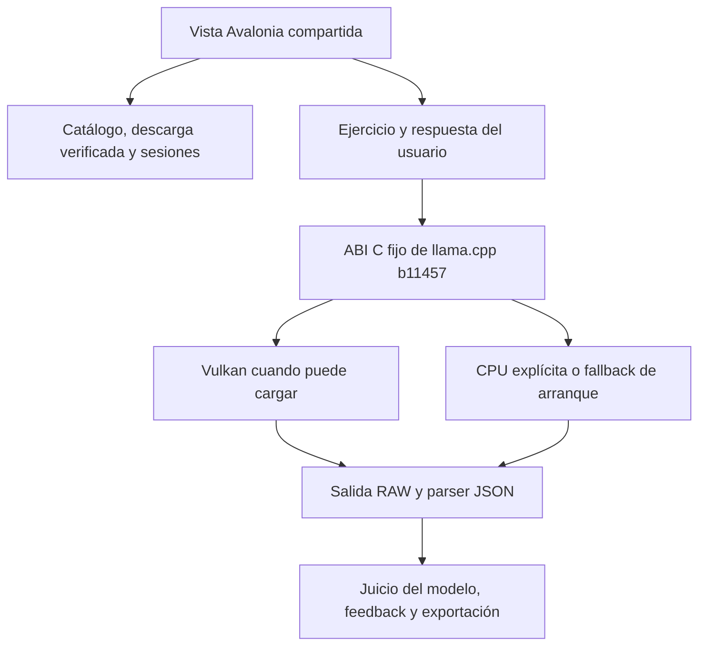

# Prototipo Avalonia Windows/Android: implementación y validación

Fecha de trabajo: 9 de noviembre de 2026. Este informe documenta una demostración tecnológica independiente de las corridas experimentales de 40/120 casos. Los archivos originales y el test final no forman parte del flujo de la aplicación.

## Objetivo y decisiones

La aplicación permite elegir y preparar un GGUF, recibir una sugerencia por capacidad del equipo, cargarlo localmente, responder un ejercicio nuevo A1/A2 y ver el JSON interpretado como juicio del modelo, corrección y retroalimentación. Se comparte la interfaz entre Windows y Android mediante Avalonia 12.1.5 y .NET 11 RC3; la supervisión de `llama-server.exe` de WinForms se sustituye por un puente C nativo dentro del proceso, apto para Android.

La demo WinForms continúa intacta. La nueva solución vive en `SLM_A1A2/cross_demo`, tiene su propio `global.json` y no modifica el SDK estable de la aplicación anterior. No se configura remoto Git ni se publica información fuera del equipo.

Se usa el commit de llama.cpp `5ad1c5da0ad7f6176256b823925aad19134f0263`, conservado en el proyecto. CMake compila llama/common/GGML y el wrapper de ABI C; las plantillas Jinja proceden del GGUF. Windows combina ese core compilado con el plugin Vulkan oficial del mismo commit; se comprobó su carga y ejecución, no solo la existencia del DLL. Android requiere bibliotecas por ABI y el loader/driver que aporta el sistema.

## Selección de modelo y descarga

La app conserva las 13 configuraciones de la demo anterior y sus hashes. Hay además dos entradas **distintas** de Qwen Unsloth descargables, con revisión y SHA propios, porque los Qwen del experimento son conversiones locales sin una URL pública de esos mismos bytes. Las nuevas entradas no heredan sus puntuaciones. Los [metadatos upstream fijados](../manifests/portable_qwen_sources_20261109.json) identifican esa diferencia.

La sugerencia inicial usa la RAM y el espacio observados al iniciar la aplicación. Su estimación es `1,45 × tamaño GGUF + 384 MiB + 64 KiB × contexto`; el presupuesto es el menor entre 75 % de RAM disponible y 45 % de RAM total. Es una heurística conservadora, no una medición de picos por arquitectura ni una garantía de carga. Se muestra el motivo y se permite elegir otro modelo. Los tamaños de interfaz usan GB decimales; los márgenes expresados en MiB usan 2²⁰ bytes.

Los GGUF se descargan por streaming a un parcial propio; tamaño, SHA-256 y cabecera se comprueban antes de publicarlo. Cancelación y errores eliminan ese parcial, sin sobrescribir archivos existentes distintos. La caché privada y las carpetas externas se recorren buscando una copia cuyo hash coincida. Una importación explícita verificada puede reparar la caché archivando su copia errónea; no mueve ni borra los modelos externos.

La importación está disponible para todas las variantes, incluido un proveedor que exija acceso. La app no acepta contratos del proveedor ni inventa URLs. Las licencias aparecen en el detalle del modelo; LFM conserva la etiqueta `lfm1.0`. No se distribuyen pesos dentro del EXE/APK.

## Generación, JSON y reintentos

- Windows usa contexto4096 y Android2048; la salida tiene un máximo de512 tokens. Se conserva el sampling por familia y thinking se desactiva en la plantilla donde existe ese control.
- El mensaje de usuario sigue `Level: {level}\nTask: {task}\nStudent text: {student_text}`. Los ejemplos solo se envían si el usuario los selecciona como su respuesta; no se envían etiquetas ni gold ocultos.
- Qwen/MiniCPM/Gemma usan el prompt propuesto a partir de la revisión del investigador, todavía pendiente de validación empírica; LFM mantiene el base. Las sesiones conservan el SHA del prompt.
- Hay un intento por defecto. Si el usuario selecciona hasta tres, se repiten los mismos inputs/prompt con semillas42/43/44 únicamente ante formato o consistencia inutilizable. Se conserva cada RAW y se guarda un checkpoint antes de otro intento. Un error técnico o cancelación no causa repetición ni cambio de backend.
- STRICT y RECOVERED son utilizables, manteniendo la distinción entre ambos; INVALID_JSON, INVALID_SCHEMA e INCONSISTENT no producen una marca concluyente de correcto/incorrecto. El parser no decide la calidad del inglés para escoger una respuesta.
- Cambiar una entrada invalida veredicto, corrección y sesión visible anteriores. Las entradas quedan bloqueadas durante carga/evaluación, con snapshot y cancelación para evitar resultados asociados a otro texto.

El fallback de Auto ocurre solo en detección/carga de Vulkan, con el mismo modelo y contexto. Vulkan explícito muestra el fallo si no puede iniciar. CPU fuerza colocación CPU y desactiva el offload de KV y operaciones. No se vuelve a emitir una generación por CPU porque el modelo produzca mal JSON.

La API pública usada no entrega un conteo fiable de capas colocadas: el wrapper registra 0 para CPU y −1, desconocido, para Vulkan. La interfaz muestra «no medidas» en ese caso. Los logs de la prueba técnica sí permiten verificar los resúmenes de offload y buffers. Ni una etiqueta de backend ni un número de capas prueban que todas las operaciones del grafo se ejecuten en GPU.

## Evidencia Windows

Equipo: RTX3070 8 GiB, Ryzen5 5600X, 16 GiB RAM, Windows x64. Se verificaron los bytes de los modelos existentes antes de cargar. El harness no descarga pesos ni accede a los benchmarks; exige `--execute`.

Se envió una respuesta nueva con error inequívoco del catálogo de demostración: `I wakes up at seven. I eat breakfast at home.`, ejercicio `demo-a1-my-day`. Las siguientes son peticiones técnicas individuales, no una comparación estadística ni una evaluación lingüística:

| Modelo/quant | Backend | Contexto | Parser | Petición (s) | Offload en log |
|---|---|---:|---|---:|---|
| LFM2.5 1.2B Q4_K_M | CPU | 2048 | INCONSISTENT | 2,734 | 0/17 |
| LFM2.5 1.2B Q4_K_M | Vulkan | 2048 | INCONSISTENT | 13,591 | 17/17 |
| MiniCPM5 2B Q4_K_M | Vulkan | 2048 | STRICT | 5,982 | 43/43 |
| Qwen3.5 4B Q4_K_M local | Vulkan | 2048 | STRICT | 16,666 | 33/33 |
| Gemma4 E2B UD-Q4_K_XL | Vulkan | 2048 | STRICT | 22,376 | 36/36 |
| LFM2.5 2.6B Q4_K_M | Vulkan | 2048 | INVALID_JSON | 3,394 | 31/31 |

El tiempo incluye prefill y puede incluir inicialización de kernels/shaders; no incluye hashing/carga. Una muestra por configuración, estados de caché distintos y contextos de plataforma distintos no permiten concluir que un backend o cuantización sea más rápido. No se ajustaron parámetros tras ver las respuestas.

Una séptima generación se hizo desde la GUI Windows: MiniCPM Q4, Vulkan, contexto4096, semilla42, ejemplo correcto `I wake up at seven. I eat breakfast at home.`. Devolvió STRICT, `is_correct=true`, texto idéntico y una sugerencia opcional en feedback. Se comprobó la marca de correcto y la presentación del RAW. Es una observación funcional, no una validación general del prompt revisado.

La sesión se exportó mediante el diálogo nativo y coincidió **byte por byte** con su checkpoint: 3386 bytes, SHA-256 `352c817a7662f4115514e9e3b84f0df6c2f01d83856209d372dc7d5af881bbca`. [Captura de la evaluación](assets/windows_demo_20261109.jpg).

Tras publicar las correcciones finales de interfaz/exportación, se abrió de nuevo el EXE publicado. Se comprobó la sugerencia de capacidad, detección de pesos locales y estado inicial sin modelo cargado; no se generó otra respuesta. La aplicación Windows quedó abierta para la prueba del usuario.

También se realizó una comprobación **sin petición de chat** con `GGML_VK_VISIBLE_DEVICES` vacío solo en el proceso del harness. Auto seleccionó CPU, contexto2048, 0 capas y motivo explícito de ausencia de backend/dispositivo Vulkan. Esta simulación no representa una desinstalación física del driver.

Los RAW, sesiones y logs están en `SLM_A1A2/logs/cross_demo/`, fuera de Git; sus hashes se indexan en el registro de entrega. Los checkpoints acumulativos duplican datos de intentos para preservarlos y no se suman como observaciones independientes.

## Android y toolchain

Se detectó Android Studio2025.2.3 con JDK21.0.8, SDK de usuario y un AVD x86_64 Android API36.1. El emulador original tenía 2GB de RAM; la ejecución de prueba lo inicia temporalmente con4GB, oculto/read-only, sin modificar la configuración original. Una GPU emulada no acredita compatibilidad/rendimiento de un teléfono físico.

El SDK .NET11 RC3 global no reconocía android: la carga instalada por Visual Studio correspondía a una preview anterior. Se preparó `.tools/dotnet11` aislado y se añadieron plataforma API37 y build-tools37.0.0 al SDK de usuario. No se actualizó Android Studio ni el SDK global. La combinación de bindings/manifiesto Android preview6 y runtime RC3 debe tratarse como toolchain experimental; el APK real incluye **CoreCLR/JIT** (`libcoreclr.so` y `libclrjit.so`), aunque la instalación también contenga paquetes Mono que no se utilizan en ese APK.

El host apunta a `net11.0-android37.0`, mínimo API26, paquete `org.kevinlima.writinglab`, con ARM64 y x86_64. NDK29.0.14206865 compila el ABI C para ambas arquitecturas. `extractNativeLibs=true` permite que GGML encuentre plugins como archivos dentro de `NativeLibraryDir`. Se incluye `libc++_shared.so` correspondiente al NDK. El APK preliminar de108289156 bytes no incluía este motor y no se entrega como funcional; se conserva como incidencia/progreso.

El inventario y los resultados finales de empaquetado/emulador se conservan en `android_environment.json` y en el registro de verificación de entrega. La ejecución física ARM64 y Vulkan en teléfonos queda para la prueba posterior autorizada por el usuario; no se infiere de la compilación.

### Prueba Android ejecutada

Se importó por el selector de documentos el LFM1.2 Q4 ya existente: 730895168 bytes, SHA-256 `b1b3de114215d9507409a662a501a631095a479a419584e8a2ded6304b19b4f5`. No se descargó otra vez de Internet. Una primera pulsación con respuesta vacía fue rechazada por validación de formulario y no invocó el modelo.

Después se realizó **una** generación CPU, contexto2048, intento1/semilla42, ejercicio `demo-a1-my-day`. La entrada registrada fue ` I wakes up at seven. I eat breakfast at home.` (incluye un espacio inicial que se conserva en la evidencia). Tiempo nativo: **18,6524295 s**, fin `stop`. El resultado fue INCONSISTENT: `is_correct=true` mientras el texto corregido cambia `wakes` a `wake`. La aplicación presentó advertencia y conservó todos los campos y RAW; no se repitió ni retocó el prompt. [Captura del resultado Android](assets/android_demo_20261109.png).

La sesión se exportó por Android SAF y se recuperó para documentación: 3145 bytes, SHA-256 `e2e4bf88fe8f85b022f09a82b2118012000fb4cf098f4087fa62ae34995519ae`. El primer nombre tenía `.json.json`; se corrigió el nombre sugerido, dejando la extensión a cargo del selector. Se añadió además truncado de streams seekables para evitar restos al sobrescribir un export más largo, con un fixture dedicado.

**Total del prototipo: ocho generaciones técnicas nuevas**, siete Windows y una Android, más una carga CPU fallida inicial y una comprobación de fallback sin chat. No se suman a las corridas de40/120 casos. No hubo generación ARM64 física ni generación GPU Android.

### APK final y alcance de GPU

`artifacts/android-final/org.kevinlima.writinglab-Signed.apk` mide **176296160 bytes**; SHA-256 `0761b54b7a4febbbe738bc814894ad81d193b778f1919c044498d119e2311983`. Se verificaron firmas v2/v3, alineación y contenido ZIP. Incluye bridge/llama/common/GGML/CPU/libc++ de ARM64 y x86_64; únicamente ARM64 incluye `libggml-vulkan.so`. El runtime efectivo es CoreCLR/JIT.

Está firmado con una clave local de desarrollo, para estas pruebas; no representa una firma de distribución de producción. Se compararon por SHA los 15 SO incluidos en el APK contra los artefactos nativos preparados: todos coinciden. También coinciden las siete DLL nativas publicadas de Windows.

El plugin Vulkan ARM64 se compiló contra el stub API28, pues API26 no exporta `vkGetPhysicalDeviceFeatures2`. Se conservó el core/CPU compilado para API26, sin sustituirlo por la build API28. Plugin: 31334096 bytes, SHA-256 `0ef0c45eb1f23dfc91c48f477814bae2abac9ef46876e740e87339f722078f9d`; depende del loader Android del sistema y no de un loader Windows. API28 es un requisito de carga del plugin, adicional a Vulkan1.2 y capacidades reales. La alternativa CPU en API26 se apoya en la carga opcional del plugin; no se validó todavía en hardware API26.

La primera actualización del emulador falló por falta de espacio:397MiB libres en `/data`. Se retiró solo el duplicado temporal del GGUF que la prueba había creado en Downloads, comprobado por hash; se preservaron el export y la caché privada. Con aproximadamente1GiB libre, `adb install -r` pudo actualizar el APK. La app volvió a arrancar y reconoció el GGUF privado. No se repitió el chat para esta comprobación final.

Se cargó el modelo por CPU en el APK final: la interfaz confirmó backend CPU y 0 capas GPU. La exportación SAF se había probado en el candidato CPU; el nombre corregido del APK final no se volvió a exportar desde Android, pues reiniciar la app no restaura una sesión anterior en la vista y se evitó otra generación. Su lógica compartida sí pasó el fixture de exportación. Tras recuperar la evidencia se cerró el emulador temporal; su overlay read-only no se conserva como instalación permanente ni altera los datos del AVD original.

## Incidencias resueltas y límites del prototipo

1. Un callback C++ de progreso interpretaba una estructura como el flag de cancelación y abortaba la carga. La primera prueba CPU falló antes de generar. Se preservó la incidencia y el hash fallido; se corrigió el puntero, recompiló y repitió la prueba técnica.
2. La revisión detectó una aceptación doble del token muestreado y una alimentación del prompt al historial que no correspondía al camino upstream usado. Se corrigieron antes de las generaciones válidas; `llama_sampler_sample` ya acepta el token.
3. Builds simultáneos Android/Desktop bloquearon PDB de Shared. Se separaron configuraciones de verificación y se serializa el publish compartido. No se borraron builds o resultados para ocultarlo.
4. El host Android necesitó tema AppCompat y el lifetime real de Avalonia12 (`IActivityApplicationLifetime.MainViewFactory`), además del flujo ISingleView del ejemplo anterior.
5. El NDK aporta C Vulkan y loader stub, pero faltaba `vulkan.hpp`. La ruta Vulkan requiere encabezados oficiales compatibles y un compilador de shaders host; los paths largos de Windows requirieron un directorio corto de build. Esto no implica cambiar ajustes de seguridad ni instalar un driver distinto.
6. Los tres subagentes Luna alcanzaron un límite de uso: se detuvo el trabajo y se guardó [el traspaso](../HANDOFF_LUNA_LIMIT_20261109.md). Solo se retomó al recibir autorización del usuario con límites renovados.

El prototipo prepara NativeAOT con bindings compilados, recursos embebidos, source generation y `LibraryImport` estático. Se probó la serialización con reflexión desactivada. No se ha certificado una publicación NativeAOT completa Windows/Android, ni rendimiento sostenido, temperaturas, memoria pico o comportamiento de todos los drivers. No hay instalador/actualizador de producción ni garantía de ejecución en cualquier equipo de poca RAM.

Las suites pasaron: **207** pruebas Python del proyecto existente; **15** fixtures de servicios compartidos del prototipo; **4** fixtures de estado UI/exportación, que incluyen seis mutaciones de entrada, historial RAW y truncado de export. No realizan inferencias de benchmark. Las compilaciones y publicaciones finales se ejecutan separando sus directorios de configuración para evitar el bloqueo de PDB observado.

## Conservación y metodología

Se volvieron a comprobar 24 artefactos de Fase1 byte-idénticos; los hashes de164 fuentes y76 derivados de evaluación v2; y93 entradas Git originales. No se modificaron los resultados humanos importados, el manifiesto experimental, CUDA, los GGUF ni las corridas históricas.

El test final de unas200 preguntas sigue sin crearse, abrirse ni consultarse. Para una comparación posterior deben fijarse candidatos, prompts, sampling y política de reintentos antes de ejecutarlo. Con recuperación de formato se reportarán éxito al primer intento y éxito acumulado por separado, junto con costo, latencia e intentos; no se atribuirá al modelo base una mejora de un mecanismo posterior sin distinguirla.

## Fuentes técnicas

- [Avalonia12.1.5, release oficial](https://github.com/AvaloniaUI/Avalonia/releases/tag/12.1.5) y metadata de los assemblies instalados para la API de lifetime.
- [NativeAOT de Avalonia](https://docs.avaloniaui.net/docs/deployment/native-aot).
- [llama.cpp, commit fijado](https://github.com/ggml-org/llama.cpp/tree/5ad1c5da0ad7f6176256b823925aad19134f0263), cabecera pública, common/chat y sampler de ese source local.
- [NDK y compiladores de shaders](https://developer.android.com/ndk/guides/graphics/shader-compilers).
- [Hugging Face, fuente Qwen portable fijada](https://huggingface.co/unsloth/Qwen3.5-4B-GGUF/tree/e87f176479d0855a907a41277aca2f8ee7a09523).
